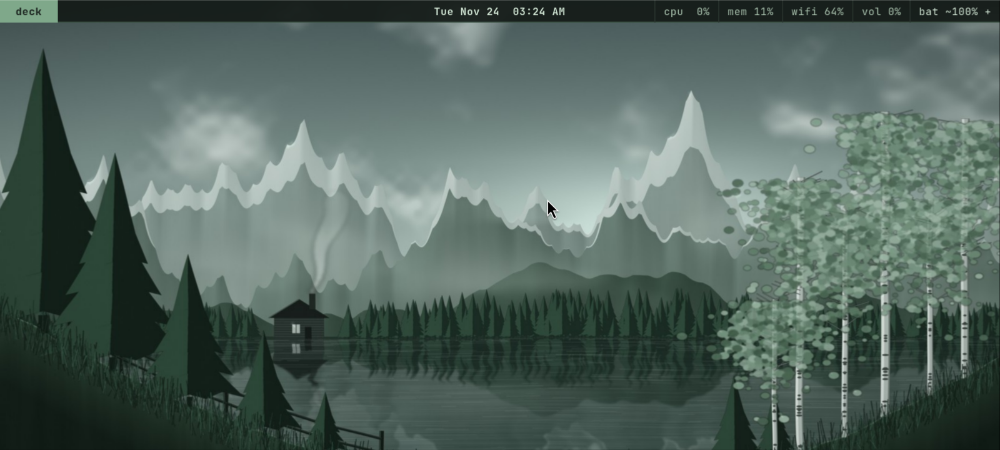

# TCL 30 SE (MT6765) - mainline Debian + GPU / video decode

## What works (2026-11-24)

| Area | State |
|---|---|
| Boot | Debian 13 (trixie) on mainline Linux 7.1, slot B, root on userdata |
| Display / touch | 720x1600 panel (simpledrm), FocalTech touch, landscape |
| GPU | PowerVR GE8320 through the vendor Android driver + libhybris: Firefox WebRender, EGL/Vulkan apps. Compositor still draws in software |
| Video | MT6765 hardware H.264 decode (`hwplay`): 1080p30, 720p60 |
| Desktops | `deck` (labwc + waybar, idle ~440 MiB RAM), XFCE on labwc, PocketShell (touch) |
| USB | Host mode for hubs/keyboards/mice, dock hot-swap, charging through a PD dock (`host-ext`) |
| Wi-Fi | Internal MT6631 (vendor connectivity stack ported to 7.1) |
| Audio | Speaker/headphone path works; speaker may be damaged on this unit |
| CPU | Optional 1.6 GHz boost (stock voltage) |
| Not working | Bluetooth, cellular, camera, HDMI over USB-C (no DP alt mode), live USB mode switching (needs reboot) |

Setup: see [SETUP.md](SETUP.md). Everything here is GPL-2.0 (see LICENSE) unless a file says otherwise; files under
`debian/src/casper-vcodec/mtk-ref/` are MediaTek GPL reference code kept for comparison.

**Experimental.** Work in progress on one phone (TCL 30 SE, 6165S "cruze_pro"). Private notes and sources, not a polished project.

| Path | What |
|---|---|
| `kernel/` | kernel source: https://github.com/School-User/TCL30SE-Linux-Kernel (branch main). Patches here: mainline 7.1 (`0001` device support, `0002` MediaTek connectivity port) and the kernel config |
| `debian/src/` | out-of-tree modules: `casper-ion`, `casper-ashmem`, `casper-gpu-dt`, `casper-vcodec` (+ `hwplay`, `vdpipe`, Firefox hand-off), `casper-dvfs` (1.6 GHz), `mt6357-jack` |
| `debian/*.sh`, `debian/initramfs/init` | boot image build and deploy scripts, initramfs init |
| `debian/HANDOFF.md`, `WIFI-PORT.md`, ... | bring-up log and per-subsystem notes |
| `gpu/` | libhybris/PowerVR bring-up, `eglplatform-casper` EGL plugin, `GPU-WRITEUP.md` |
| `pocketshell/` | git submodule -> https://github.com/School-User/PocketShell (clone with `--recurse-submodules`): the custom Wayland home shell, sway/Sxmo config and session units |
| `notes/` | project state, device facts, GSI (Android) notes |
| `home/`, `killbg/`, `bootlogo/` | small Android-side apps and boot logo (GSI era) |

**Not in this repo** (see `.gitignore`): vendor/firmware blobs (`debian/firmware`, `harvest`), built `.ko` files, boot and system images, backups, signing keys. The firmware blobs come from the stock Android image.
